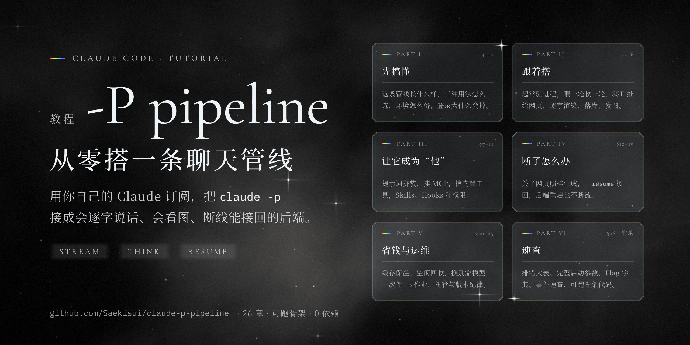

# claude-p-pipeline

[简体中文](README.md) | **日本語**

<p align="center"></p>

自分の Claude サブスクリプションを使って、Claude Code の `claude -p` を常駐する AI エージェントとして動かし、完全なチャットパイプラインに組み上げます。文字単位のストリーミング、思考過程（thinking）、ツール呼び出し、画像の送信、カスタムツール（MCP）、スキル、切断からの再開、バックエンドを再起動しても応答が失われない仕組みまでを扱います。

このリポジトリには 2 つのものが入っています。

- **[TUTORIAL.md](TUTORIAL.md)**（中国語）：ゼロから構築できるところまでを解説するチュートリアルです。全 26 章＋付録 5 つ。未経験の方が順番に手を動かしながら進めることも、まるごと AI コーディングエージェントに渡して実装の参考資料にすることもできます。
- **[mini-chat/](mini-chat/)**：チュートリアル付録 D の、実際に動くスケルトン（最小構成）です。依存パッケージはなく、バックエンド 1 つ＋Web ページ 1 つ＋MCP のサンプル 1 つ＋スモークテスト 1 つで構成されています。

内容は、筆者が数か月にわたって自分で運用してきた対話型 AI エージェントのチャットパイプラインから整理したものです。各項目には根拠の種類を明記しています：公式ドキュメントに記載／比較実験済み／本番環境で稼働中／非公開パラメーター／未検証。

## まず動かしてみる

必要なもの：Node.js 18 以上。Claude Code をインストールし、サブスクリプションのアカウント（Pro / Max）でログイン済みであること（ターミナルで `claude -p "ping"` に応答が返ること）。

```bash
git clone https://github.com/Saekisui/claude-p-pipeline
cd claude-p-pipeline
npm start                  # デフォルトは sonnet。利用枠を節約したい場合：MODEL=haiku npm start
```

ブラウザーで http://127.0.0.1:3456 を開きます。`?chat=xxx` を付けると、別の会話ウィンドウを開けます。

> ⚠️ 環境変数に `ANTHROPIC_API_KEY` があると、Claude Code はサブスクリプションではなく API の従量課金で動作します。スケルトンは spawn 時にこの変数を自動で削除しますが、ご自身でターミナルからテストするときは `env -u ANTHROPIC_API_KEY claude …` を使ってください。

Claude Code をアップデートしたら、スモークテストを一度実行し、6 項目すべてが通ることを確認してから使ってください。

```bash
npm run smoke              # デフォルトは haiku。専用のポートとテスト用ウィンドウを使い、終了後は自動で後片付けします
```

## チュートリアルの内容

| 部 | 内容 |
|---|---|
| 第 1 部 · 全体像をつかむ | パイプラインの全体像、3 つの使い方の比較、環境準備、ログインが切れる理由 |
| 第 2 部 · 手を動かして作る | 常駐プロセスの起動 → 1 ターンずつ入力して受け取る → SSE で Web ページへ配信 → ストリーミング描画と保存 → 画像の送信 |
| 第 3 部 · 自分の AI エージェントに仕立てる | システムプロンプトの差し替えと組み立て、MCP の接続、不要な組み込みツールの除外、Skills / スラッシュコマンド / Hooks、権限とセキュリティ |
| 第 4 部 · 切断への対処 | Web ページの切断、停止ボタン、`--resume` による再開（トランスクリプトの切り詰め、コールドリビルド、フォークを含む）、プロセスの監視（スーパーバイザー）、ホットスワップ、バックグラウンドタスク、制御チャネル |
| 第 5 部 · コスト削減と運用 | キャッシュとその維持、アイドルプロセスの回収、他社モデルへの切り替え、単発の `-p` ジョブ、利用枠のプローブ、常駐運用とバージョン管理のルール、課金ポリシー |
| 第 6 部 · リファレンス | トラブルシューティング一覧、起動オプションの全体、フラグ辞典、イベント早見表、スケルトンのコード、思考過程（thinking）表示の経緯調査 |

## スケルトンで実装したこと・していないこと

実装済み：会話ウィンドウごとに 1 プロセスの常駐 `claude -p`、stream-json による双方向通信、ターンの順番制御、SSE＋ハートビート、Web ページを閉じても生成を継続、順序どおりの保存、画像の送信、ペルソナ設定ファイルのホットリロード（`--system-prompt-snapshot off` を含む）、MCP の接続とウィンドウ ID の受け渡し、許可リスト方式の権限設定、停止ボタン、`--resume` による再開、Web ページの接続が切れた後の突き合わせ。

未実装（チュートリアルで解説しているので、必要に応じて追加してください）：パスワード、トランスクリプトの切り詰め、コールドリビルド、プロセスの監視、キャッシュの維持、アイドルプロセスの回収、バックグラウンドタスクの結果通知。

**スケルトンは `127.0.0.1` でのみ待ち受け、パスワードはありません。インターネットに公開する前に、必ずパスワードを追加してください**（チュートリアル §11.4）。

## 越えてはいけない一線

この仕組みは「自分のサブスクリプション＋自分の PC＋自分で使う」ためのものです。claude.ai のログインやサブスクリプションの利用枠を自社製品のユーザーに提供することは、公式に禁止されています。これをサービスとして他人に使わせると、この一線を越えることになります（チュートリアル §25）。

## 動作確認環境

Claude Code 2.1.282、Node.js 18 以上、macOS。2026-11-07 に確認。非公開パラメーター（`--thinking-display` など）はバージョンによって使えなくなる可能性があるため、アップデート後はまずスモークテストを実行してください。

## License

[AGPL-3.0](LICENSE)
