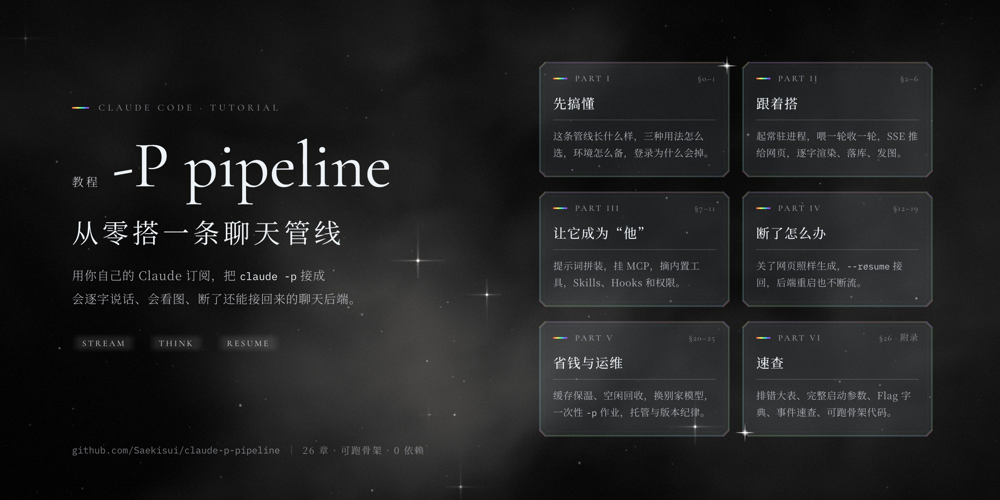

# claude-p-pipeline

<p align="center"></p>

用你自己的 Claude 订阅，把 Claude Code 的 `claude -p` 接成一条完整的聊天管线：逐字流式、思考链、工具调用、发图、自定义工具（MCP）、技能、断线续接、后端重启不丢回复。

这里有两样东西：

- **[TUTORIAL.md](TUTORIAL.md)**：从零讲到能搭。26 章 + 5 个附录，0 基础可以照着一步一步做，也可以整份丢给 AI 编程助手当实现参考。
- **[mini-chat/](mini-chat/)**：教程附录 D 的可跑骨架。零依赖，一个后端 + 一个网页 + 一个 MCP 示例 + 一个冒烟测试。

内容从一条自用了几个月的陪伴聊天管线里整理出来，每一条都标了来源：官方文档写明 / 做过对照实验 / 生产环境在跑 / 隐藏参数 / 未实测。

## 先跑起来

需要：Node.js 18+；装好 Claude Code，并用订阅账号（Pro / Max）登录过（终端里 `claude -p "ping"` 能回答）。

```bash
git clone https://github.com/Saekisui/claude-p-pipeline
cd claude-p-pipeline
npm start                  # 默认用 sonnet；想省额度：MODEL=haiku npm start
```

浏览器打开 http://127.0.0.1:3456 ，加 `?chat=xxx` 可以开不同的窗口。

> ⚠️ 环境里如果有 `ANTHROPIC_API_KEY`，Claude Code 会走 API 按量计费，不走订阅。骨架 spawn 时会自动删掉它，你自己在终端里测试时记得用 `env -u ANTHROPIC_API_KEY claude …`。

升级 Claude Code 之后跑一遍冒烟测试，六项都过了再放心用：

```bash
npm run smoke              # 默认用 haiku；用独立端口和独立测试窗口，跑完自己清理
```

## 教程讲了什么

| 部分 | 内容 |
|---|---|
| 一 · 先搞懂 | 这条管线长什么样、三种用法对比、环境准备、登录为什么会掉 |
| 二 · 跟着搭 | 起常驻进程 → 喂一轮收一轮 → SSE 推给网页 → 流式渲染与落库 → 发图片 |
| 三 · 让它成为“他” | 系统提示词替换与拼装、挂 MCP、摘掉不需要的内置工具、Skills / 斜杠命令 / Hooks、权限与安全 |
| 四 · 断了怎么办 | 网页断、停止键、`--resume` 接回（含截断转录、冷重建、分叉）、进程管家、热切换、后台任务、控制通道 |
| 五 · 省钱与运维 | 缓存与保温、空闲回收、换别家模型、一次性 `-p` 作业、额度探针、托管与版本纪律、计费政策 |
| 六 · 速查 | 排错大表、完整启动参数、Flag 字典、事件速查、骨架代码、思考链考古 |

## 骨架做了什么、没做什么

做了：一窗一进程的常驻 `claude -p`、stream-json 双向、轮次守门、SSE + 心跳、关网页不停生成、按顺序落库、发图、人格档热更新（含 `--system-prompt-snapshot off`）、挂 MCP 并传窗口 id、白名单权限、停止键、`--resume` 续接、网页断流对账。

没做（教程里有讲，按需自己加）：密码、转录截断、冷重建、进程管家、缓存保温、空闲回收、后台任务回报。

**骨架只监听 `127.0.0.1`、没有密码。放到公网之前一定先加密码**（教程 §11.4）。

## 红线

这套是“自己的订阅 + 自己的电脑 + 自己用”。官方禁止把 claude.ai 登录或订阅额度提供给你产品的用户；把它包装成服务给别人用，就越线了（教程 §25）。

## 基准

Claude Code 2.1.282，Node.js 18+，macOS。2026-11-07 核对。隐藏参数（如 `--thinking-display`）随版本可能失效，升级后先跑冒烟。

## License

[AGPL-3.0](LICENSE)
